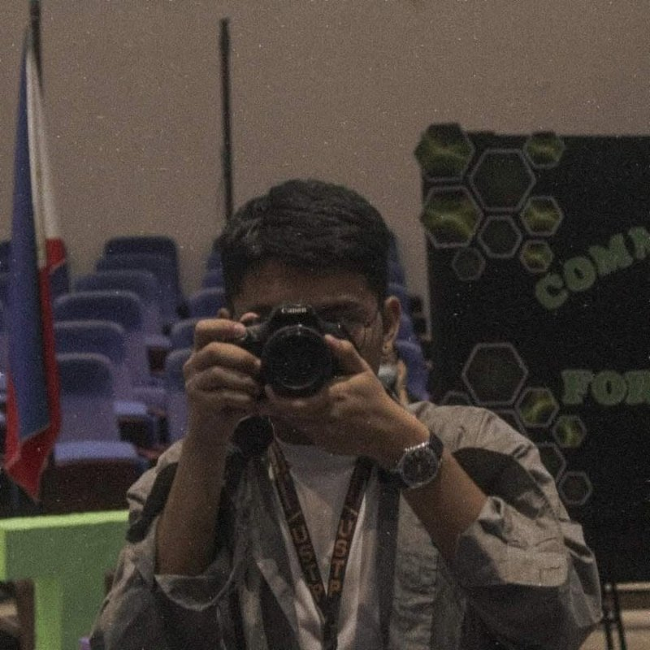

# Kyle Mallari

::::{div}
:class: hero

:::{div}
:class: hero-text

**BS Data Science student focused on machine learning and deep learning.**

This portfolio collects my laboratory work on neural networks and PyTorch. Each notebook explains the concept, shows the code, and includes the outputs.

[View notebooks](#notebooks)
[Contact me](#contact)
:::

```python
player = {
    "program": "BS Data Science",
    "year_level": "4th Year",
    "focus": ["machine learning", "deep learning"],
    "framework": "PyTorch",
}
```

::::

## About

:::{div}
:class: book

I'm a fourth-year BS Data Science student who wants to turn data into useful insights and build systems that learn from it. My coursework so far covers the foundations of deep learning, how artificial neural networks work, tensor operations in PyTorch, and applied work on convolutional neural networks.
:::

(notebooks)=
## Notebooks

::::{div}
:class: project-grid

:::{div}
:class: project

### Foundations of Deep Learning

How deep learning developed and where it sits within artificial intelligence. Covers machine learning, neural networks, computer vision, natural language processing, and generative AI.

[Read the notebook](notebooks/00_Foundational%20Concept%20of%20Deep%20Learning.ipynb)
:::

:::{div}
:class: project

### Understanding Deep Learning

An introduction to artificial neural networks and how they learn from and process information.

[Read the notebook](notebooks/01_Understanding%20Deep%20Learning.ipynb)
:::

:::{div}
:class: project

### PyTorch Basics

Working with PyTorch tensors: creation, attributes, indexing, slicing, reshaping, arithmetic, dot products, matrix multiplication, and NumPy integration.

[Read the notebook](notebooks/02_PyTorch%20Basics.ipynb)
:::

:::{div}
:class: project

### Applications of Deep Learning

Practical applications of deep learning using neural networks and modern machine learning techniques.

[Read the notebook](notebooks/E%20-%20Applications%20of%20Deep%20Learning.ipynb)
:::

:::{div}
:class: project

### CNN Implementation

A hands-on implementation of a Convolutional Neural Network, covering the major components involved in image-based deep learning.

[Read the notebook](notebooks/E1%20-%20CNN%20Implementation.ipynb)
:::

:::{div}
:class: project

### Model Inference Lab

Evaluating pre-trained computer vision models (EfficientNet, ResNet, etc.) on a custom food dataset using PyTorch.

[Read the notebook](notebooks/Model_Inference_Lab.ipynb)
:::
::::

## Skills and tools

::::{div}
:class: skill-groups

:::{div}
:class: skill-group

**Languages**

- Python
- R
:::

:::{div}
:class: skill-group

**Libraries**

- NumPy
- Pandas
- Matplotlib
- Scikit-learn
- PyTorch
:::

:::{div}
:class: skill-group

**Tools**

- Jupyter
- Git
- GitHub
:::

::::

## My workflow

:::{div}
:class: book

I'm building a solid foundation in the full data science workflow, and I plan to apply it to projects with real-world datasets.
:::

:::{div}
:class: workflow

1. Data
2. Exploration
3. Analysis
4. Modeling
5. Evaluation
6. Deployment
:::

## Currently studying

:::{div}
:class: study

- Machine learning
- Deep learning
- Data visualization
- Statistical analysis
- Artificial intelligence
- Model development
:::

## Gallery

::::{div}
:class: gallery

:::{div}
:class: shot



Camera in hand
:::

:::{div}
:class: shot


In costume
:::

:::{div}
:class: shot


Cool cat
:::

::::

(contact)=
## Contact

:::{div}
:class: contact

- GitHub: [mallariroquekyle-prog](https://github.com/mallariroquekyle-prog)
- Email: [mallari.roquekyle@gmail.com](mailto:mallari.roquekyle@gmail.com)
- LinkedIn: [Roque Kyle Mallari](https://www.linkedin.com/in/roque-kyle-mallari-04b401396/)
:::